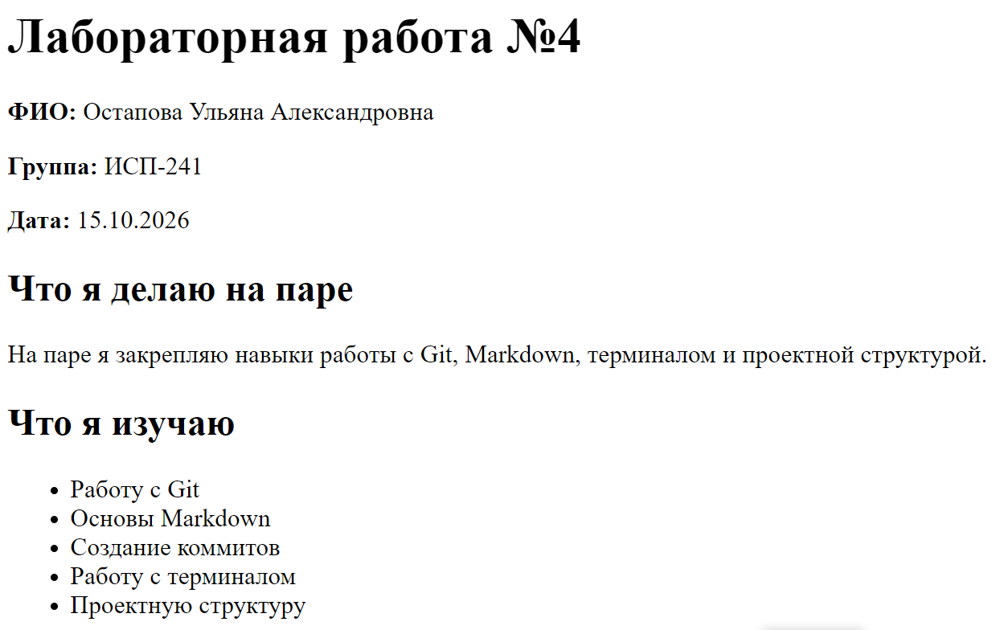

# H1 - Заголовок первого уровня
## H2 - Заголовок второго уровня
### H3 - Заголовок третьего уровня
#### H4 - Заголовок четвёртого уровня
##### H5 - Заголовок пятого уровня
###### H6 - Заголовок шестого уровня
---
___
***
## Форматирование текста
**Жирный текст**
*Курсив*
~~Зачёркнутый текст~~
`Моноширный текст`

## Списки
#### Маркированный список
- Первый пункт
- Второй пункт
- Третий пункт
#### Нумерованный список
1. Первый пункт
2. Второй пункт
3. Третий пункт
#### Вложенный список
- Первый пункт
    - Первый подпункт
    - второй подпункт
- Второй пункт
    - Первый подпункт
    - второй подпункт

## Цитата
> Пример цитаты
## Блок кода
```bash
git status
```
## Таблица
|Функция | Команда Git | Описание|
|:-------|:-----------:|--------:|
|Создание репозитория|**git init**|Инициализация репозитория|
|Просмотр состояния	|**git status**|Показывает изменённые файлы|
|Отправка на GitHub	|**git push**|Загружает коммиты на сервер|

## Картинка


## Ссылки
Внешняя ссылка:
[GitHub](https://github.com/)
Внутренняя ссылка:
[код program](..obj/Program.cs)

## Чекбоксы
- [x] Сделано
- [ ] Не сделано

## Alert-блоки GitHub
> [!NOTE]
> Примечание

## Inline LaTeX
$a^2 + b^2 = c^2$

## Block LaTeX
$$
\sum_{i=1}^n i = \frac{n(n+1)}{2}
$$